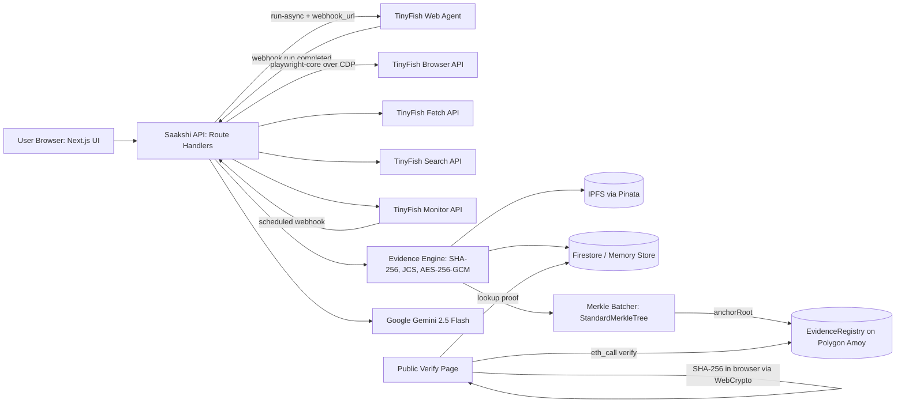

# Saakshi (साक्षी)

[](https://github.com/siddh2803-ryu/web3-Saakshi/actions/workflows/ci.yml)

**An AI witness for the internet.** Agentic, tamper-proof, court-ready web evidence. Captured by TinyFish web agents, fingerprinted with SHA-256, and anchored on Polygon.

Built by **Team Eclipse** for **KRITICAL HACKS '26** (AssetMerkle &times; IGDTUW), Web3 Track.

---

## 1. Problem & Innovation
Harassing social posts, fraudulent job offers, consumer scams, and defamatory content are frequently edited or deleted within hours. Victims rely on device screenshots, which courts and platforms distrust because client-side screenshots are easily altered with DevTools or image editors.

Under **Section 63(4) of the Bharatiya Sakshya Adhiniyam, 2023 (BSA)**, upheld by the Supreme Court of India in *Pune Bar Association v. Union of India* (May 2026), electronic evidence must be accompanied by a certificate disclosing the record's cryptographic hash value and details of lawful custody.

**Saakshi automates this entire pipeline:**
1. Autonomous **TinyFish web agents** browse the target page like a neutral human witness, documenting every action into a replayable step-by-step filmstrip.
2. Every plaintext artifact is hashed with **SHA-256** and structured into an **RFC 8785 (JCS)** canonical manifest.
3. Artifacts are sealed with **AES-256-GCM** envelope encryption and pinned to **IPFS**.
4. The manifest hash is anchored into an OpenZeppelin **Merkle Tree** on **Polygon Amoy**, establishing an unalterable timestamp.
5. **TinyFish Monitor** watches the page for alterations or deletions, generating instant diffs and automatic re-captures.
6. **Google Gemini** summarizes facts, identifies parties, drafts bilingual complaints (English & Hindi), and produces a **draft Part A certificate under s.63(4) BSA, 2023**.
7. **Trustless Public Verification**: Anyone can verify evidence in their browser via WebCrypto and direct Polygon RPC calls, with zero trust in Saakshi's servers.

---

## 2. How Saakshi Uses TinyFish
Saakshi integrates all five core products across the TinyFish automation suite:

| TinyFish Product | Purpose in Saakshi | Code Implementation |
|---|---|---|
| **Web Agent** (`/v1/automation/run-async`) | Autonomous goal-driven web browsing, popup bypass, comment expansion, and forensic action trace. | [`apps/web/lib/tinyfish/agent.ts`](apps/web/lib/tinyfish/agent.ts) |
| **Browser API** (CDP sessions) | Managed cloud Chromium sessions capturing full-page PNG, PDF, DOM HTML, network response logs, and TLS security details. | [`apps/web/lib/tinyfish/browser.ts`](apps/web/lib/tinyfish/browser.ts) |
| **Fetch API** (`api.fetch.tinyfish.ai`) | Token-efficient clean markdown extraction with HTTP status codes and metadata. | [`apps/web/lib/tinyfish/fetch.ts`](apps/web/lib/tinyfish/fetch.ts) |
| **Monitor API** (`/v1/monitors`) | Scheduled Page Monitor detecting content alteration and HTTP 404 deletion, powering the live diff engine. | [`apps/web/lib/tinyfish/monitor.ts`](apps/web/lib/tinyfish/monitor.ts) |
| **Search API** (`api.search.tinyfish.ai`) | Reverse mirror and repost finder using exact-phrase quoted web queries. | [`apps/web/lib/tinyfish/search.ts`](apps/web/lib/tinyfish/search.ts) |

---

## 3. Architecture & Data Flow



---

## 4. Smart Contract Details
- **Contract Name**: `EvidenceRegistry.sol`
- **Network**: Polygon Amoy Testnet (Chain ID: `80002`)
- **Standard**: OpenZeppelin `AccessControl` + `MerkleProof`
- **Leaf Encoding**: `StandardMerkleTree` with `["bytes32"]`
- **Verified Explorer**: [https://amoy.polygonscan.com](https://amoy.polygonscan.com)
- **Contract Code**: [`contracts/contracts/EvidenceRegistry.sol`](contracts/contracts/EvidenceRegistry.sol)

### Trustless Verification Guarantee
Anyone possessing an artifact or manifest can verify its existence and authenticity without trusting Saakshi:
1. Open `/verify` in any browser.
2. Drag and drop the file.
3. The browser calculates the SHA-256 hash locally using `crypto.subtle.digest("SHA-256", bytes)`; the file is never uploaded.
4. The browser queries the public Polygon Amoy RPC directly via `eth_call verify(manifestHash, proof, root)`.

---

## 5. Getting Started & Local Development

### Prerequisites
- Node.js >= 20.0.0
- npm >= 10.0.0

### Setup
1. Clone the repository:
   ```bash
   git clone https://github.com/Team-Eclipse-KH26/saakshi.git
   cd saakshi
   ```

2. Install dependencies:
   ```bash
   npm install
   ```

3. Configure environment variables:
   ```bash
   cp .env.example .env.local
   ```
   Fill in your API keys in `.env.local`:
   - `TINYFISH_API_KEY`: Your TinyFish platform key.
   - `GEMINI_API_KEY`: Google Gemini API key.
   - `MASTER_KEY_B64`: 32 random bytes in base64 (generate with `node -e 'console.log(require("crypto").randomBytes(32).toString("base64"))'`).
   - `ANCHOR_PRIVATE_KEY`: Private key for the Polygon Amoy anchoring node.

4. Run tests:
   ```bash
   # Run smart contract unit tests (100% pass)
   npm run test:contracts

   # Run evidence cryptography, JCS, and pipeline unit tests (100% pass)
   npm run test:web
   ```

5. Run development server:
   ```bash
   npm run dev
   ```
   Open [http://localhost:3000](http://localhost:3000) in your browser.

---

## 6. Offline Verification Script
To verify an evidence bundle offline via command line:
```bash
npx ts-node scripts/verify.ts <path-to-unzipped-bundle>
```
The script independently canonicalizes `manifest.json`, checks all artifact hashes, and validates the Merkle inclusion proof against Polygon Amoy.

---

## 7. Legal Disclaimer & Indian Evidence Act Note
- **Section 63(4) BSA, 2023 Compliance**: Saakshi produces a **draft Part A certificate** disclosing hash values and system provenance.
- **Part B Requirement**: Under Indian law, Part B of the certificate must be signed by a qualified electronic evidence expert. Saakshi provides drafting assistance and cryptographic proof; it does not substitute for licensed legal counsel.

---

## 8. Team Eclipse
Built with dedication for **KRITICAL HACKS '26**:
- **Siddharth Dhawan**: Lead Full-Stack & Systems Architecture
- **Pratham Jaiswal**: Web3, Smart Contracts & Merkle Batching
- **Parnika Agarwal**: TinyFish Agent Orchestration & Pipeline
- **Navya Khurana**: AI Prompt Engineering, UI/UX & BSA 2023 Research
