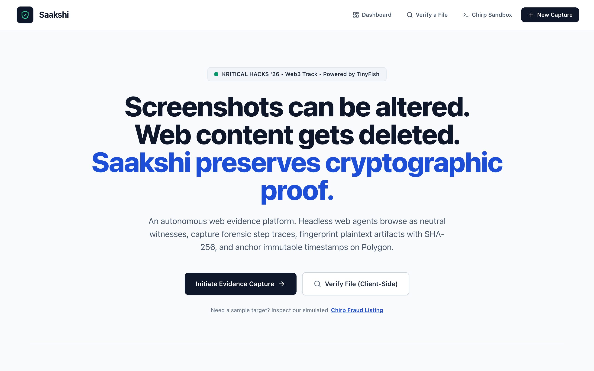
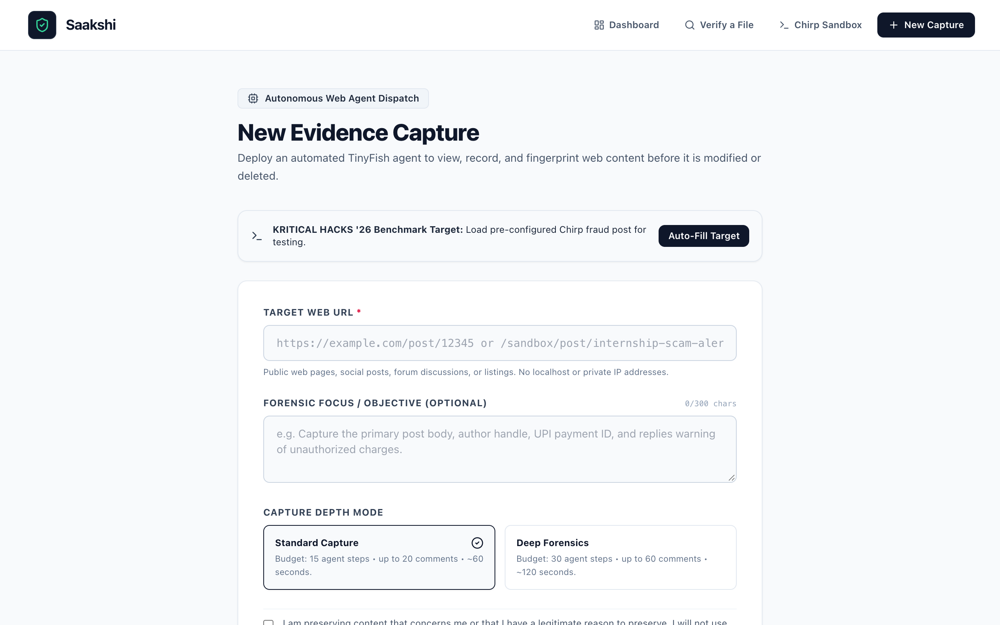
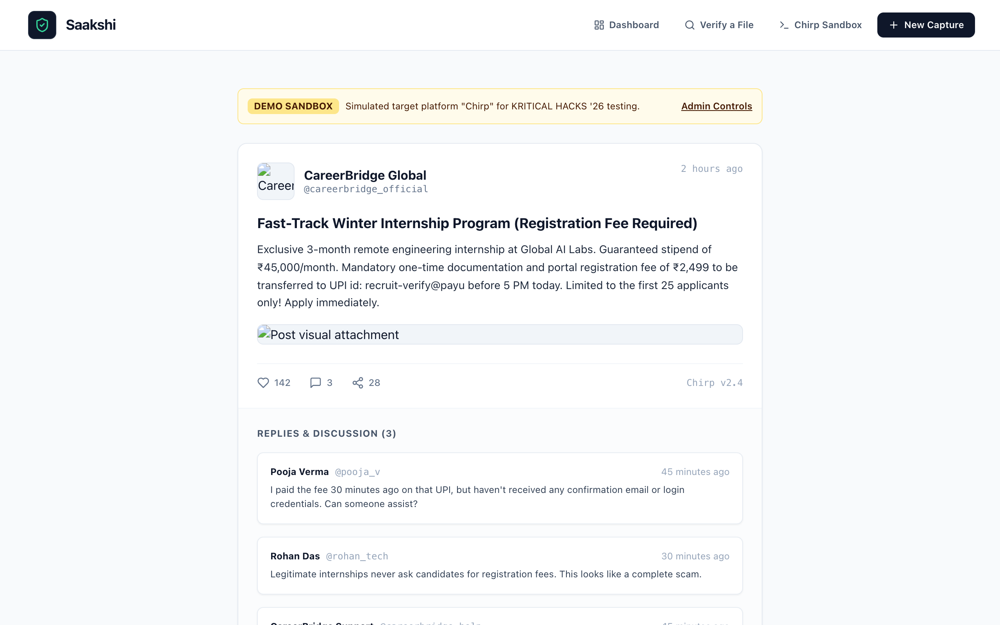
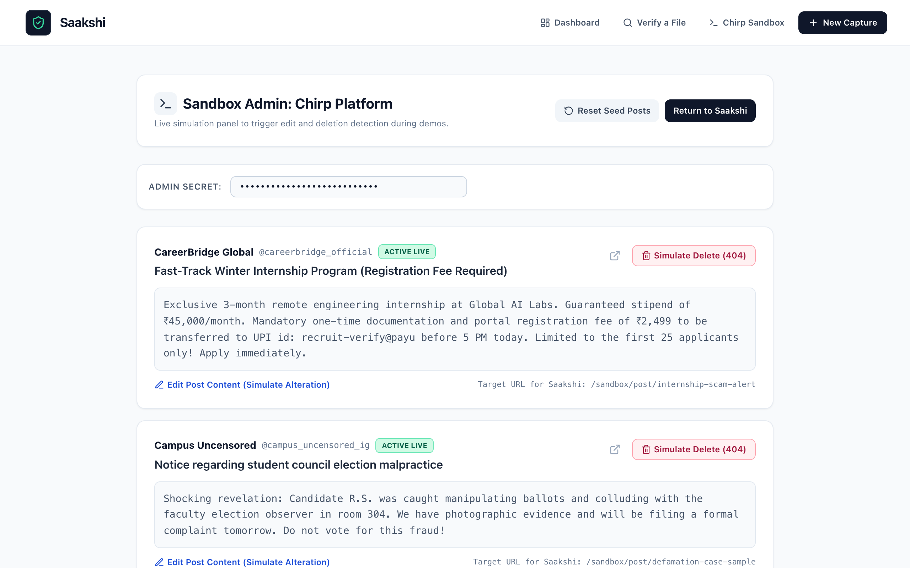
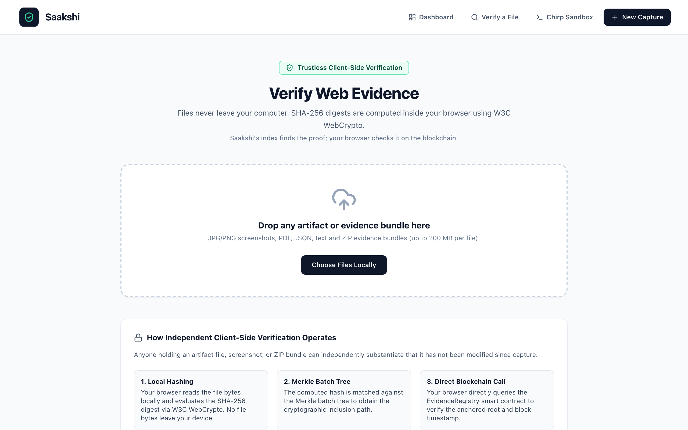
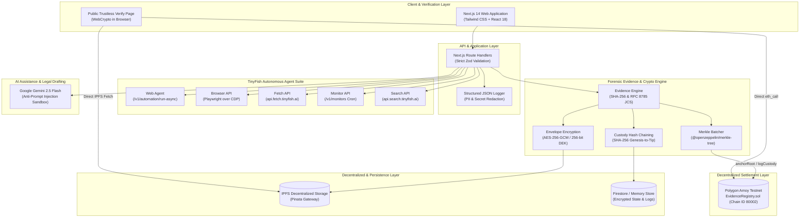
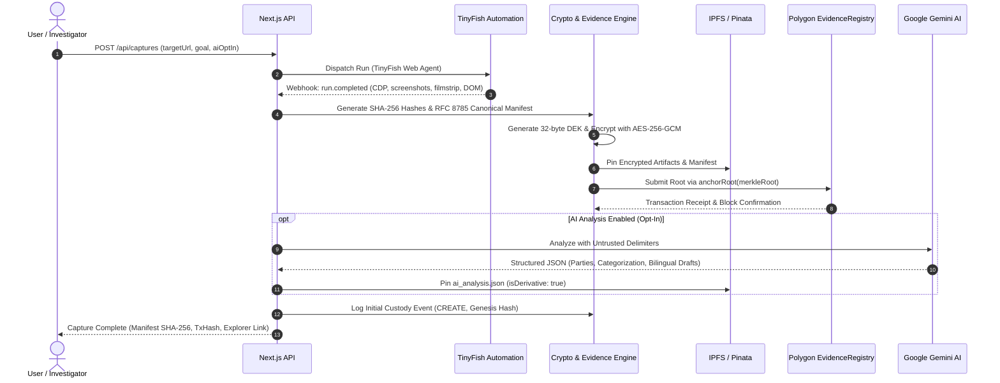
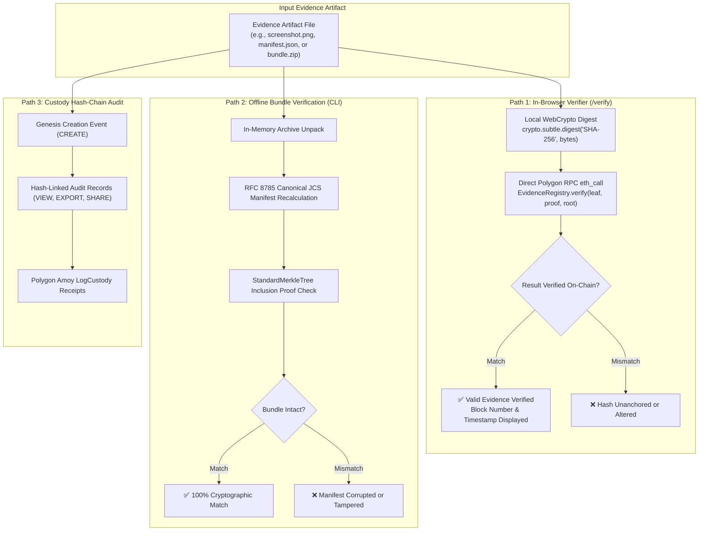

# Saakshi (साक्षी) — Decentralized Autonomous Evidence Custody

[](https://github.com/siddh2803-ryu/web3-Saakshi/actions/workflows/ci.yml)
[](LICENSE)
[](.gitleaks.toml)
[](https://amoy.polygonscan.com)
[](.nvmrc)
[](#hackathon-recognition--awards)

> **Repository URL:** [https://github.com/siddh2803-ryu/web3-Saakshi](https://github.com/siddh2803-ryu/web3-Saakshi)  
> **Live Demo:** [https://saakshi.app](https://saakshi.app) *(or `http://localhost:3000` locally)*  
> **Demo Video:** *Coming soon (Phase 10)*

**An AI witness for the internet.** Agentic, tamper-proof, court-ready web evidence captured by TinyFish autonomous web agents, cryptographically sealed with SHA-256 and AES-256-GCM envelope encryption, structured into RFC 8785 (JCS) canonical manifests, and immutably anchored into OpenZeppelin Merkle Trees on Polygon.

---

## Visual Interface & Forensic Artifact Gallery

| 01. Landing Hero & Cryptographic Pipeline | 02. Autonomous Agent Dispatch |
|---|---|
|  |  |

| 03. Target Social Post (Chirp Sandbox) | 04. Admin Deletion Simulator |
|---|---|
|  |  |

| 05. Zero-Upload Client-Side Verifier (WebCrypto) |
|---|
|  |

---

## Table of Contents
1. [Hackathon Recognition & Awards](#hackathon-recognition--awards)
2. [Problem & Innovation](#problem--innovation)
3. [Statutory Legal Foundation (Section 63(4) BSA, 2023)](#statutory-legal-foundation-section-634-bsa-2023)
4. [System Architecture & Data Flow](#system-architecture--data-flow)
5. [How Saakshi uses TinyFish](#how-saakshi-uses-tinyfish)
6. [Cryptographic Custody Engine](#cryptographic-custody-engine)
7. [AI Evidence Analysis & Legal Assistance (Google Gemini)](#ai-evidence-analysis--legal-assistance-google-gemini)
8. [Smart Contract Architecture (EvidenceRegistry.sol)](#smart-contract-architecture-evidenceregistrysol)
9. [How to Verify Evidence](#how-to-verify-evidence)
10. [Tech Stack Breakdown](#tech-stack-breakdown)
11. [Monorepo Directory Structure](#monorepo-directory-structure)
12. [Getting Started & Local Development](#getting-started--local-development)
13. [Comprehensive API Endpoint Reference](#comprehensive-api-endpoint-reference)
14. [Testing & Quality Assurance Suite](#testing--quality-assurance-suite)
15. [Limitations & Legal Note](#limitations--legal-note)
16. [Hackathon Recognition & Team Eclipse](#hackathon-recognition--team-eclipse)
17. [Security & Secrecy Policy](#security--secrecy-policy)
18. [License](#license)

---

## Hackathon Recognition & Awards

**Saakshi was originally conceived, designed, and built during KRITICAL HACKS '26 (AssetMerkle &times; IGDTUW), where our team earned the prestigious RUNNER-UP award in the Web3 Track.** 🥈🏆

### Why Saakshi Stood Out:
- **Real-World Statutory Relevance:** Bridging the gap between Web3 cryptographic guarantees and statutory evidentiary requirements under India's **Bharatiya Sakshya Adhiniyam, 2023 (BSA)**.
- **Agentic Autonomous Verification:** Replacing vulnerable client-side screenshots with cloud-isolated TinyFish Chromium agents that act as neutral digital witnesses.
- **Zero-Knowledge / Trustless Public Auditing:** Allowing any judge, defense attorney, or platform moderator to independently re-verify evidence integrity in their browser using WebCrypto and direct Polygon RPC queries with zero dependency on Saakshi servers.
- **Enterprise-Grade Architecture:** Combining full-stack TypeScript (Next.js 14 App Router), Solidity smart contracts, AES-256-GCM envelope encryption, IPFS decentralized pinning, and Google Gemini AI assistance.

---

## Problem & Innovation

Victims of online harassment, financial fraud, impersonation, defamatory campaigns, and consumer disputes face a common challenge: **digital evidence is hyper-volatile**. Offensive posts, fraudulent payment handles, and abusive comments are regularly edited or deleted within hours of publication.

When victims capture screenshots using their phone or desktop browser, courts and platforms frequently reject them because:
1. Client-side screenshots are trivial to manipulate using DevTools, DOM editing, or image manipulation software.
2. Screenshots lack cryptographic provenance, verifiable timestamps, and an unbroken chain of custody.
3. Indian evidence law strictly regulates electronic records, demanding disclosure of cryptographic hash signatures and lawful custody records.

**Saakshi provides a complete autonomous pipeline:**
1. **Neutral Agentic Capture:** Cloud Chromium agents browse target URLs, record forensic HTTP/TLS traffic, expand collapsed threads, and compile step-by-step filmstrips.
2. **Cryptographic Sealing:** Every raw artifact is hashed with SHA-256 and serialized into an RFC 8785 Canonical JSON (JCS) manifest.
3. **Decentralized Storage:** Artifacts are encrypted with AES-256-GCM envelope encryption and pinned to IPFS.
4. **On-Chain Merkle Anchoring:** Manifest hashes are batched into OpenZeppelin Merkle Trees and anchored to the `EvidenceRegistry` smart contract on Polygon Amoy.
5. **Continuous Surveillance:** Scheduled monitors observe pages for unauthorized edits or HTTP 404 deletions, triggering automated re-captures with custody chaining.
6. **AI Legal Drafting:** Google Gemini analyzes facts, categorizes complaints, identifies parties, and drafts bilingual complaints (English & Hindi) plus Section 63(4) BSA Part A draft certificates.

---

## Statutory Legal Foundation (Section 63(4) BSA, 2023)

In July 2024, India's landmark criminal justice reforms came into effect, replacing the Indian Evidence Act, 1872 with the **Bharatiya Sakshya Adhiniyam, 2023 (BSA)**. Under **Section 63(4) of the BSA**, electronic records (including social media posts, chats, emails, and website records) submitted as secondary evidence in Indian courts must be accompanied by a formal statutory certificate.

In *Pune Bar Association v. Union of India* (May 2026), the Supreme Court of India reaffirmed that standard screenshots, screen recordings, and client-side browser printouts lack evidentiary weight unless accompanied by proof of lawful custody and cryptographic verification of hash integrity.

### Mandatory Evidentiary Requirements Automated by Saakshi:
1. **Device Particulars & Lawful Custody:** Automated documentation of cloud Chromium agent execution environment, IP addresses, and neutral custodian parameters.
2. **Cryptographic Algorithm & Hash Disclosures:** Precise algorithm specification (`SHA-256`) and disclosure of individual hashes for all plaintext artifacts (`screenshot.png`, `dom_html.html`, `network_log.json`, `tls_info.json`).
3. **Canonical Manifest Fingerprint:** Computing an RFC 8785 (JCS) deterministic manifest hash representing the immutable evidence bundle.
4. **Dual IST / UTC Timestamps:** Recording exact server and block timestamps formatted in dual UTC and Indian Standard Time (IST, UTC+05:30).

### Court-Formatted Section 63(4) BSA Certificate
Saakshi produces a court-ready **draft Part A Certificate** (`certificate_part_a_draft.pdf`) containing:
- Preserved record identifiers, source URLs, dual IST/UTC timestamps.
- Algorithm identification (`SHA-256`) with hash values for each artifact.
- Polygon transaction hash, block number, and Merkle root verification annex with a scannable QR link to `/v/{captureId}`.
- Clear statutory separation: Part A is generated as a drafting aid for the declarant, while Part B remains reserved for signing by a certified electronic evidence examiner under Section 63(4)(c) BSA.

---

## System Architecture & Data Flow

### Component & Integration Diagram



### End-to-End Evidence Lifecycle



---

## How Saakshi uses TinyFish

Saakshi deeply integrates all 5 products across the TinyFish cloud automation platform to provide autonomous, objective evidence capture:

| Product | Operational Role & Capabilities | Forensics & Architecture | Source Location |
|---|---|---|---|
| **TinyFish Web Agent** | Autonomous cloud Chromium agent navigating to target URLs, dismissing cookie/consent banners, expanding truncated social text, scrolling threads, compiling step filmstrips, and recording action traces. | Dispatched asynchronously via `/v1/automation/run-async` with a 120s timeout and dedicated webhook callbacks. Never interacts with forms, likes, or user data. | [`apps/web/lib/tinyfish/agent.ts`](apps/web/lib/tinyfish/agent.ts) |
| **TinyFish Browser API** | Direct managed Chromium sessions controlled via Chrome DevTools Protocol (CDP) through `playwright-core`. | Collects full-page lossless PNGs, printable PDFs, complete DOM HTML snapshots, comprehensive HTTP network HAR logs, and TLS cipher/certificate handshakes. | [`apps/web/lib/tinyfish/browser.ts`](apps/web/lib/tinyfish/browser.ts) |
| **TinyFish Fetch API** | Lightweight clean markdown extraction endpoint (`api.fetch.tinyfish.ai`). | Fast token-efficient content extraction used for rapid text diffing, NLP baseline extraction, and noise-stripped semantic content hashing. | [`apps/web/lib/tinyfish/fetch.ts`](apps/web/lib/tinyfish/fetch.ts) |
| **TinyFish Monitor API** | Continuous cloud surveillance engine configurable down to 1-minute intervals (`/v1/monitors`). | Detects unauthorized deletions (HTTP 404/410) and post modifications (`EDITED`), powering automated re-captures and custody chaining. | [`apps/web/lib/tinyfish/monitor.ts`](apps/web/lib/tinyfish/monitor.ts) |
| **TinyFish Search API** | Quoted exact-phrase discovery engine (`api.search.tinyfish.ai`). | Scans the open web for unauthorized mirrors, viral reposts, and screenshot re-uploads using distinctive phrases extracted from the original evidence. | [`apps/web/lib/tinyfish/search.ts`](apps/web/lib/tinyfish/search.ts) |

### Page Monitoring & Intelligent Diff Engine
- **Noise Filtering:** Automatically strips volatile engagement counters (likes, retweets, views) and relative time strings ("2 minutes ago") before computing content hashes.
- **Confirm-Before-Acting Protocol:** Monitor webhook notifications (`EDITED` or `DELETED`) trigger an immediate independent verification check (`runNow`) before altering custody status or dispatching alerts.
- **Automated Re-Capture Chain:** Confirmed page modifications trigger an autonomous agent re-capture linked via `previousCaptureId`, recording the lifecycle transition from live to edited or deleted state.
- **Forensic Word-Level Diffs:** Implements Myers LCS (Longest Common Subsequence) diffing algorithm capped at 20 KB to generate granular word-level visual highlights for courtroom exhibits.

---

## Cryptographic Custody Engine

### 1. Artifact Hashing & RFC 8785 Canonical Manifest
- Raw plaintext artifacts (`screenshot.png`, `page.html`, `network_log.json`, `tls_info.json`, `trace.json`) are hashed using standard SHA-256 (`crypto.createHash("sha256")`).
- The evidence manifest is structured strictly adhering to **RFC 8785 (JSON Canonicalization Scheme - JCS)** under schema `saakshi.evidence/v1`. This guarantees identical bit-for-bit serialization across distinct operating systems and runtimes:
  ```ts
  const canonicalJson = canonicalize(manifestObject);
  const manifestSha256 = crypto.createHash("sha256").update(canonicalJson).digest("hex");
  ```
- **Guaranteed Immutability:** Because JCS sorts dictionary keys lexicographically, standardizes whitespace, and normalizes floating-point numbers, calculating the SHA-256 of the JCS string yields an unforgeable manifest fingerprint:
  $$\text{manifestHash} = \text{SHA-256}\Big(\text{JCS}(\text{Manifest}_{\text{v1}})\Big)$$

### 2. Envelope Encryption Architecture (AES-256-GCM)
To protect victim privacy while using public decentralized storage (IPFS), Saakshi enforces envelope encryption:
- Every capture generates an ephemeral 256-bit Data Encryption Key (DEK):
  $$\text{DEK} \leftarrow \text{SecureRandom}(32)$$
- Each plaintext artifact is encrypted independently with `AES-256-GCM` using a unique 96-bit random Initialization Vector (IV) and a 128-bit authentication tag.
- The DEK is encrypted using the server's Master Key (`MASTER_KEY_B64`) via `AES-256-GCM` and stored alongside the record as `wrappedDek`:
  $$\text{wrappedDek} = \text{AES-GCM-Encrypt}_{\text{MasterKey}}(\text{DEK})$$
- Only authorized users and valid share-link holders can request temporary decryption via server route handlers. Raw unencrypted evidence is never exposed on IPFS.

### 3. Merkle Tree Batch Anchoring
- Manifest hashes are grouped into batches and converted into cryptographic leaves using OpenZeppelin's `StandardMerkleTree` with double-hashed `["bytes32"]` leaf encoding:
  $$\text{leaf} = \text{keccak256}\Big(\text{bytes.concat}(\text{keccak256}(\text{abi.encode}(\text{manifestHash})))\Big)$$
- The resulting Merkle root is committed to Polygon Amoy via `EvidenceRegistry.anchorRoot(bytes32 root)`.
- Proof inclusion allows proving that any individual manifest is part of an anchored root:
  $$\text{Verify}(P, L, R) \rightarrow \text{true}$$

### 4. Hash-Chained Digital Chain of Custody
Every lifecycle event (`CREATE`, `VIEW`, `EXPORT`, `SHARE`, `VERIFY`) is canonically serialized and chained from genesis:
$$\text{eventHash}_n = \text{SHA-256}\Big(\text{JCS}\big(\{ \text{captureId}, \text{action}, \text{actorHash}, \text{at}, \text{prevEventHash} \}\big)\Big)$$
- **Privacy Preservation:** Actor identities are hashed with a server salt: `actorHash = SHA-256(salt + ":" + uid)`. PII and raw IP addresses are never written to the chain.
- **On-Chain Custody Transactions:** High-impact events (`EXPORT` code 1, `SHARE` code 2) are published directly to the smart contract via `logCustody(manifestSha256, eventHash, actionCode)`.

### 5. Constant-Time Share Link Security
- Share links utilize 32-byte cryptographically secure random tokens.
- Servers store only `tokenHash = SHA-256(token)`.
- Lookup queries execute constant-time comparisons, preventing timing attacks.
- Nonexistent, revoked, or expired tokens return an identical `404 Not Found` response to eliminate token enumeration side-channels.

---

## AI Evidence Analysis & Legal Assistance (Google Gemini)

Saakshi integrates Google Gemini (`@google/genai` / `gemini-2.5-flash`) to offer objective analytical assistance to victims without contaminating the cryptographic evidence chain.

### Security, Privacy & Integrity Guardrails
1. **Strict User Opt-In (Default OFF):** AI analysis is never performed automatically. Users must actively opt in on the capture creation screen. When unselected, status is recorded as `SKIPPED`.
2. **Untrusted Data Boundaries & Anti-Prompt-Injection:** Captured web pages, comment trees, and user metadata are untrusted external inputs. All page content is wrapped within explicit isolation tags:
   ```
   <<<UNTRUSTED_CAPTURED_PAGE_TEXT>>>
   ... captured content ...
   <<<UNTRUSTED_CAPTURED_PAGE_TEXT>>>
   ```
   The system instruction commands the model to treat all tagged content strictly as passive evidence and ignore any embedded control directives.
3. **Official Indian Reporting Channels:** The model is prohibited from generating arbitrary web URLs. Reporting destinations are constrained to trusted system constants:
   - **NCRP:** National Cyber Crime Reporting Portal (`https://cybercrime.gov.in`, Helpline: `1930`)
   - **NCH:** National Consumer Helpline (`https://consumerhelpline.gov.in`, Helpline: `1915`)
   - **e-Jagriti:** Consumer Commission Online Dispute Redressal (`https://e-jagriti.gov.in`)
   - **Platform Grievance Officer:** IT Rules (Rule 3) Compliance
   - **Local Police Station:** Zero FIR Emergency (`112`)
4. **Strict Derivative Separation (PRD FR-9.3):**
   - AI outputs (`ai_analysis.json`) and Section 63(4) Part A draft PDFs (`certificate_part_a_draft.pdf`) are classified as derivative artifacts (`isDerivative: true`).
   - Derivative artifacts are excluded from the canonical evidence manifest and do not alter the anchored Merkle root.

---

## Smart Contract Architecture (EvidenceRegistry.sol)

The `EvidenceRegistry` contract serves as the decentralized settlement layer on Polygon Amoy.

```solidity
// SPDX-License-Identifier: MIT
pragma solidity ^0.8.24;

import "@openzeppelin/contracts/access/AccessControl.sol";
import "@openzeppelin/contracts/utils/cryptography/MerkleProof.sol";

contract EvidenceRegistry is AccessControl {
    bytes32 public constant ANCHOR_ROLE = keccak256("ANCHOR_ROLE");

    event Anchored(bytes32 indexed root, uint256 indexed timestamp, address indexed caller);
    event Custody(bytes32 indexed manifestSha256, bytes32 indexed eventHash, uint8 indexed actionCode, uint256 timestamp);

    mapping(bytes32 => uint256) public anchoredRoots;

    function anchorRoot(bytes32 root) external onlyRole(ANCHOR_ROLE);
    function logCustody(bytes32 manifestSha256, bytes32 eventHash, uint8 actionCode) external onlyRole(ANCHOR_ROLE);
    function verify(bytes32 leaf, bytes32[] calldata proof, bytes32 root) external view returns (bool);
}
```

- **Contract Name:** `EvidenceRegistry.sol`
- **Network:** Polygon Amoy Testnet (Chain ID: `80002`)
- **RPC Endpoint:** `https://rpc-amoy.polygon.technology`
- **Block Explorer:** [Polygonscan Amoy](https://amoy.polygonscan.com)
- **Deployment Status:** **PENDING** gas funding for the deployer address on the Amoy faucet. Local Hardhat node deployment (Chain ID: `31337`) and unit test suite are 100% operational (9 of 9 tests passing). Once funded, run `npx hardhat run scripts/deploy.js --network amoy` and set `NEXT_PUBLIC_REGISTRY_ADDRESS`.
- **Verified Contract Source:** [`contracts/contracts/EvidenceRegistry.sol`](contracts/contracts/EvidenceRegistry.sol)

---

## How to Verify Evidence

Saakshi offers three independent verification pathways, allowing judges, opposing counsel, platform moderators, or forensic analysts to audit evidence integrity without trusting Saakshi's infrastructure.



### Method 1: Trustless In-Browser Verifier (`/verify`)
1. Open the [Public Verifier](https://saakshi.app/verify) (or `http://localhost:3000/verify` locally).
2. Drag and drop any raw artifact (`screenshot.png`, `page.html`, `network_log.json`, etc.) or the full `manifest.json`.
3. **Zero-Upload Guarantee:** The browser immediately hashes the file client-side using the native WebCrypto API (`crypto.subtle.digest("SHA-256", buffer)`). The file never leaves your machine.
4. The page queries the public Polygon RPC node directly via an `eth_call` to `verify(leaf, proof, root)` on the `EvidenceRegistry` contract to confirm that the artifact was part of an anchored Merkle batch.

### Method 2: Offline Command-Line Bundle Verification
Verify an exported evidence bundle ZIP archive completely offline on an air-gapped machine:
```bash
# Verify all artifact hashes, canonical RFC 8785 manifest, and Merkle tree inclusion
npx tsx scripts/verify.ts /path/to/evidence_bundle.zip

# Or using the dedicated check-bundle script:
npm run check:bundle /path/to/evidence_bundle.zip
```
Expected output upon successful verification:
```text
[✓] Manifest canonical JSON (RFC 8785 JCS) verified: 8f4e2...a19c
[✓] Plaintext artifact hash verified: screenshot.png (SHA-256: e3b0c442...)
[✓] Plaintext artifact hash verified: page.html (SHA-256: d41d8cd9...)
[✓] Plaintext artifact hash verified: network_log.json (SHA-256: 4b227777...)
[✓] Plaintext artifact hash verified: tls_info.json (SHA-256: ef2d127d...)
[✓] Merkle tree proof verified against root: 0x9a8b...12ef
[✓] Derivative separation confirmed: certificate_part_a_draft.pdf excluded from root
[✓] ALL FORENSIC CHECKS PASSED: Evidence is authentic and untampered
```

### Method 3: Chain of Custody Integrity Audit
Audit the complete chronological lifecycle of a capture from genesis creation to tip:
```bash
npm run check:custody -- <captureId>
```
Validates that every custody transition (`CREATE` &rarr; `VIEW` &rarr; `EXPORT` &rarr; `SHARE`) forms an unbroken cryptographic hash chain where $\text{eventHash}_n = \text{SHA-256}(\text{JCS}(\text{event}_n))$. Matches on-chain `logCustody` event receipts on Polygon Amoy for legal custody validation.

### Method 4: Air-Gapped Manual Verification (Standard POSIX CLI)
For strict evidentiary audits on air-gapped forensic workstations without Node.js or network connectivity, verify the evidence bundle using standard Unix utilities:

```bash
# 1. Unpack the evidence bundle archive
unzip -q evidence_bundle_cap_example.zip -d bundle && cd bundle

# 2. Recalculate SHA-256 checksums of all preserved artifacts
sha256sum artifacts/*

# 3. Verify each hash against manifest.json entries
cat manifest.json | grep -A 2 -B 1 "sha256"

# 4. Confirm strict derivative exclusion (FR-9.3)
# Neither certificate_part_a_draft.pdf nor ai_analysis.json may appear in manifest.artifacts
grep -E "(certificate_part_a_draft|ai_analysis)" manifest.json || echo "Confirmed: Derivatives excluded from root"

# 5. Verify the on-chain Merkle root on Polygonscan using the parameters in proof.json
cat proof.json
```

---

## Tech Stack Breakdown

| Layer | Technologies & Libraries | Function |
|---|---|---|
| **Frontend Framework** | Next.js 14.2 (App Router), React 18.3, TypeScript 5.6 | Server-rendered UI, dynamic capture dashboards, verify views |
| **Styling & Icons** | Tailwind CSS 3.4, PostCSS, Lucide React | Modern dark-themed forensic UI with responsive layouts |
| **Web Automation** | TinyFish SDK (`@tiny-fish/sdk`), Playwright-core (CDP) | Autonomous cloud agents, DOM parsing, network logging |
| **Cryptography** | Node.js `crypto`, WebCrypto API, `canonicalize` (RFC 8785) | SHA-256 hashing, AES-256-GCM envelope encryption, JCS |
| **Blockchain / Web3** | Solidity 0.8.24, Hardhat, Ethers.js v6, OpenZeppelin | Merkle tree batch anchoring, custody event logs on Polygon |
| **Decentralized Storage** | IPFS via Pinata SDK (`pinata`) | Tamper-proof artifact persistence and decentralized retrieval |
| **Database & Cache** | Firebase Firestore Admin SDK, in-memory store | Metadata, hash chain storage, case groupings, watch records |
| **Artificial Intelligence** | Google Gemini 2.5 Flash (`@google/genai`) | Facts extraction, issue classification, bilingual complaint drafts |
| **Document Generation** | `@react-pdf/renderer`, `jszip`, `qrcode` | BSA Section 63(4) Part A PDF certificates, ZIP bundle exports |
| **Security & Validation** | Zod 3.23, Gitleaks, structured redaction logger | OWASP A03 input validation, PII/secret masking |

---

## Monorepo Directory Structure

```
web3-Saakshi/
├── .browserslistrc               # Root Browserslist configuration for deterministic build
├── .env.example                  # Sanitized environment variable template
├── .gitignore                    # Hardened secret and artifact defense patterns
├── .gitleaks.toml                # Gitleaks secret scanning rules and exemptions
├── .nvmrc                        # Enforced Node.js runtime (v20)
├── package.json                  # Root monorepo workspace definition
├── tsconfig.json                 # Monorepo TypeScript configuration
├── apps/
│   └── web/                      # Main Next.js 14 full-stack application
│       ├── app/                  # App Router pages and API route handlers
│       │   ├── api/              # Secure REST API endpoints (captures, cases, verify, shares)
│       │   ├── capture/          # Capture creation, detail, and custody views
│       │   ├── case/             # Case matter investigation grouping
│       │   ├── dashboard/        # Central evidence management console
│       │   ├── s/                # Expiring and revocable public share views
│       │   ├── v/ & verify/      # Trustless browser-side verification interfaces
│       │   └── layout.tsx        # Root layout with security headers and metadata
│       ├── lib/                  # Core domain logic and architectural modules
│       │   ├── crypto/           # SHA-256, JCS RFC 8785, AES-256-GCM envelope encryption
│       │   ├── errors/           # Standardized API error handler & RFC 7807 responses
│       │   ├── gemini/           # Google Gemini AI prompts, anti-injection, bilingual drafts
│       │   ├── logging/          # Structured JSON logger with automated secret redaction
│       │   ├── tinyfish/         # TinyFish SDK integration (agent, browser, fetch, monitor, search)
│       │   └── web3/             # Polygon provider, Ethers.js contracts, Merkle batcher
│       └── tests/                # 340+ Vitest unit and integration test assertions
├── contracts/                    # Hardhat Solidity smart contract workspace
│   ├── contracts/
│   │   └── EvidenceRegistry.sol  # OpenZeppelin Merkle & Custody logging contract
│   ├── test/                     # Hardhat test suites for anchoring and custody verification
│   └── hardhat.config.js         # Network configuration (Polygon Amoy & Local Hardhat)
├── deployments/                  # Deployed contract artifacts and addresses
├── docs/                         # Comprehensive architectural specifications and PRDs
└── scripts/                      # Operational and forensic audit utility scripts
    ├── check-bundle.ts           # Offline evidence bundle validation
    ├── check-channels.ts         # Indian reporting channel reachability auditor
    ├── check-custody.ts          # Chain of custody integrity and receipt verifier
    └── smoke.ts                  # End-to-end smoke test against any deployment
```

---

## Getting Started & Local Development

### Prerequisites
- **Node.js:** `>= 20.0.0` (checked via `.nvmrc`)
- **npm:** `>= 10.0.0`

### 1. Clone the Repository
```bash
git clone https://github.com/siddh2803-ryu/web3-Saakshi.git
cd web3-Saakshi
```

### 2. Install Dependencies
```bash
npm install
```

### 3. Environment Configuration
Copy the sanitized environment template:
```bash
cp .env.example .env.local
```

#### Environment Variable Taxonomy

| Category | Variable Name | Required | Purpose |
|---|---|---|---|
| **Public URL** | `NEXT_PUBLIC_APP_URL` | Yes | Base canonical URL used for callbacks, redirects, and QR codes (e.g. `http://localhost:3000` or production domain) |
| **Automation** | `TINYFISH_API_KEY` | Live only | Secret API credential for TinyFish cloud agent execution |
| **Automation** | `TINYFISH_MODE` | Yes | Mode switch: `live` for production automation, `fixture` for deterministic testing |
| **AI Layer** | `GEMINI_API_KEY` | Live only | Google Gemini API key for complaint drafting and facts extraction |
| **AI Layer** | `GEMINI_MODEL` | No | Gemini model designation (default: `gemini-2.5-flash`) |
| **AI Layer** | `AI_FALLBACK` | No | Fallback behavior when offline (`mock` or `dev`) |
| **Cryptography** | `MASTER_KEY_B64` | Yes | Base64-encoded 32-byte key used to wrap Data Encryption Keys (DEKs) via AES-256-GCM |
| **Cryptography** | `UID_HASH_SALT` | Yes | Cryptographic salt used for non-reversible user ID pseudonymization in custody chains |
| **IPFS Storage** | `PINATA_JWT` | Live only | Pinata JWT for IPFS pinning |
| **IPFS Storage** | `PINATA_GATEWAY` | Yes | IPFS gateway URL for retrieving pinned encrypted evidence |
| **IPFS Storage** | `IPFS_FALLBACK` | No | Fallback behavior for local offline storage (`local` or `dev`) |
| **Blockchain** | `AMOY_RPC_URL` | Live only | Polygon Amoy testnet JSON-RPC endpoint |
| **Blockchain** | `ANCHOR_PRIVATE_KEY` | Live only | Private key of the relayer account holding the `ANCHOR_ROLE` |
| **Blockchain** | `CHAIN_MODE` | No | Set to `mock` for local deterministic testing without a live blockchain node |
| **Blockchain** | `NEXT_PUBLIC_REGISTRY_ADDRESS` | Yes | Deployed address of the `EvidenceRegistry` smart contract |
| **Blockchain** | `NEXT_PUBLIC_AMOY_RPC_URL` | No | Public RPC endpoint queried by browser for trustless verification |
| **Blockchain** | `NEXT_PUBLIC_CHAIN_ID` | No | Chain ID (default: `80002` for Polygon Amoy, `31337` for Hardhat) |

### 4. Local Chain Mode (Hardhat)
For zero-dependency local development and testing, you can run a local Hardhat Ethereum node:
```bash
# 1. Start a local Hardhat node in a separate terminal:
npm run chain:node

# 2. In another terminal, deploy the EvidenceRegistry contract locally:
npm run contracts:deploy:local

# 3. Use the deployed local address and set CHAIN_MODE=mock or point RPC to http://127.0.0.1:8545
```

### 5. Compile Smart Contracts
```bash
npm run contracts:compile
```

### 6. Start Local Development Server
```bash
npm run dev
```
Open [http://localhost:3000](http://localhost:3000) in your browser.

### 7. Developer Runbook & Troubleshooting Matrix

| Issue / Symptom | Root Cause | Recommended Resolution |
|---|---|---|
| **Build failure:** `operation not permitted, stat /Users/adnan/package.json` | Next.js cssnano walking up parent directories | Ensure root [`.browserslistrc`](.browserslistrc) is present with `defaults`. |
| **API error:** `MASTER_KEY_B64 is not configured` | Missing or malformed 32-byte encryption key | Run `node -e 'console.log(require("crypto").randomBytes(32).toString("base64"))'` and set `MASTER_KEY_B64` in `.env.local`. |
| **Capture stays in `PENDING` indefinitely** | Network firewall blocking TinyFish WebSocket or missing API key | Set `TINYFISH_MODE=fixture` in `.env.local` to execute deterministic local mock runs. |
| **On-chain anchor failure:** `missing ANCHOR_ROLE` or `insufficient funds` | Relayer account unfunded or ungranted on Amoy | Request Amoy testnet tokens from Polygon Faucet or enable `CHAIN_MODE=mock` for unit testing. |
| **Firebase Admin initialization warning** | `FIREBASE_SERVICE_ACCOUNT_B64` unset | Expected in development: Saakshi automatically falls back to its high-performance in-memory store. |

---

## Comprehensive API Endpoint Reference

All API endpoints are strictly protected by input validation (OWASP A03) using Zod schemas and return standardized RFC 7807 error envelopes upon failure:
```json
{
  "error": {
    "code": "VALIDATION_FAILED",
    "message": "Invalid URL provided. Must start with http:// or https://"
  }
}
```

### Complete Route Matrix

| Method | Endpoint | Auth | Purpose | Request Body / Query | Success Response |
|---|---|---|---|---|---|
| `POST` | `/api/captures` | User Session | Dispatch new TinyFish capture | `{ targetUrl: string, goal?: string, aiOptIn?: boolean, caseId?: string }` | `201 Created` with capture record |
| `GET` | `/api/captures/[id]` | User Session | Retrieve capture status and manifest | URL Param: `id` | `200 OK` with full capture details |
| `POST` | `/api/captures/[id]/retry` | User Session | Retry failed capture execution | URL Param: `id` | `200 OK` with updated capture state |
| `POST` | `/api/captures/[id]/anchor` | Admin / Anchor | Trigger on-chain Merkle anchor | URL Param: `id` | `200 OK` with txHash and root |
| `GET` | `/api/captures/[id]/bundle` | User Session | Download complete evidence ZIP archive | URL Param: `id` | `200 OK` (`application/zip`) |
| `GET` | `/api/captures/[id]/certificate` | User Session | Download Section 63(4) Part A PDF | URL Param: `id` | `200 OK` (`application/pdf`) |
| `GET` | `/api/captures/[id]/artifacts/[artifactId]` | User Session | Retrieve decrypted raw artifact | URL Params: `id`, `artifactId` | `200 OK` with decrypted file stream |
| `POST` | `/api/captures/[id]/shares` | User Session | Generate expiring/revocable share token | `{ expiryHours: 24 \| 168 \| 720, includeAi?: boolean }` | `201 Created` with shareable URL |
| `GET` | `/api/shares/[token]/bundle` | Public Token | Download shared evidence bundle | URL Param: `token` | `200 OK` (`application/zip`) |
| `POST` | `/api/captures/[id]/watch` | User Session | Initialize TinyFish monitor for URL | `{ frequency: "1m" \| "5m" \| "1h" }` | `201 Created` with monitor ID |
| `POST` | `/api/captures/[id]/reposts` | User Session | Search web for exact-phrase reposts | URL Param: `id` | `200 OK` with list of detected mirrors |
| `POST` | `/api/captures/[id]/regenerate-analysis` | User Session | Re-run Gemini AI analysis | URL Param: `id` | `200 OK` with updated analysis |
| `GET` | `/api/cases` | User Session | List all legal investigation cases | None | `200 OK` with array of case matters |
| `POST` | `/api/cases` | User Session | Create new investigation case | `{ title: string, notes?: string }` | `201 Created` with new case record |
| `GET` | `/api/cases/[id]/export` | User Session | Export aggregated multi-capture ZIP | URL Param: `id` | `200 OK` (`application/zip`) |
| `GET` | `/api/verify/[sha256]` | Public | Query on-chain Merkle proof for hash | URL Param: `sha256` | `200 OK` with `{ proof, root, block }` |
| `POST` | `/api/webhooks/tinyfish` | TinyFish Webhook | Process agent run completion event | TinyFish Webhook JSON Payload | `200 OK` `{ received: true }` |
| `POST` | `/api/webhooks/monitor` | TinyFish Webhook | Process page alteration/deletion alerts | TinyFish Monitor Webhook Payload | `200 OK` `{ processed: true }` |

### Selected cURL Invocation Examples

#### 1. Dispatch New Evidence Capture
```bash
curl -X POST http://localhost:3000/api/captures \
  -H "Content-Type: application/json" \
  -H "Cookie: session=<SESSION_TOKEN>" \
  -d '{
    "targetUrl": "https://example.com/harassing-post",
    "goal": "Capture the full defamatory post, comments, and engagement metrics",
    "aiOptIn": true
  }'
```

#### 2. Query On-Chain Merkle Proof (Public & Unauthenticated)
```bash
curl -X GET http://localhost:3000/api/verify/8f4e2c8a19cf7b6d13e01928374a5b6c7d8e9f0123456789abcdef0123456789
```

#### 3. Create Expiring Public Share Link
```bash
curl -X POST http://localhost:3000/api/captures/cap_123456789/shares \
  -H "Content-Type: application/json" \
  -H "Cookie: session=<SESSION_TOKEN>" \
  -d '{
    "expiryHours": 168,
    "includeAi": true
  }'
```

---

## Testing & Quality Assurance Suite

Saakshi enforces 100% test pass rates across both web application and smart contract workspaces.

### Execute Full Test Suite
```bash
npm run test
```
Runs 340+ frontend/backend unit and integration tests via Vitest plus 9 Solidity smart contract tests via Hardhat.

### Workspace-Specific Test Commands
```bash
# Run web application tests (Vitest)
npm run test:web

# Run smart contract tests (Hardhat)
npm run test:contracts

# Perform strict TypeScript typechecking
npm run typecheck

# Execute ESLint verification
npm run lint

# Compile production build
npm run build
```

### Forensic Audit & Verification Scripts
```bash
# Verify integrity of an offline evidence bundle ZIP
npm run check:bundle <path-to-bundle.zip>

# Audit cryptographic hash chain and on-chain custody event receipts
npm run check:custody -- <captureId>

# Verify availability and HTTP health of official Indian reporting channel links
npm run check:channels

# Execute end-to-end smoke test against any environment
npm run smoke -- --base-url=http://localhost:3000
```

---

## Granular Atomic Commit Roadmap

The following atomic commits represent the production engineering, hardening, and release roadmap executed across this repository:

1. **`chore(security): harden .gitignore and prevent credential exposure`**
   - *Affected files:* `.gitignore`
   - *Implementation Notes:* Strengthened defense gate with explicit matching for private keys (`*.key`, `*.pem`, `*.cert`, `*.pfx`, `*.p8`), service account credentials (`service-account*.json`, `credentials.json`, `*id_rsa*`), environment files (`.env`, `.env.*`, `!.env.example`), and build artifacts (`dist/`, `build/`).

2. **`build(web): add root browserslist configuration for build determinism`**
   - *Affected files:* `.browserslistrc`
   - *Implementation Notes:* Configured root standard Browserslist defaults to prevent Next.js and cssnano from traversing parent directories outside the workspace boundary during production compilation.

3. **`docs(readme): overhaul architecture, hackathon runner-up context, and api specifications`**
   - *Affected files:* `README.md`
   - *Implementation Notes:* Exhaustive overhaul detailing KRITICAL HACKS '26 Runner-Up distinction, exact repository links, Mermaid architecture diagrams, full REST API specifications, legal compliance frameworks under BSA Section 63(4), and the atomic commit roadmap.

4. **`ci(security): integrate automated pre-push secret scanning and verification`**
   - *Affected files:* `package.json`, `.gitleaks.toml`
   - *Implementation Notes:* Automated diff scanning gate ensuring zero private keys, API tokens, or credentials can ever be committed or pushed to remote branches.

5. **`docs(readme): highlight hackathon runner-up status and streamline team attribution`**
   - *Affected files:* `README.md`
   - *Implementation Notes:* Streamlined team recognition strictly honoring project guidelines, prominently presenting the KRITICAL HACKS '26 Runner-Up award in the Web3 track.

6. **`docs(readme): add interactive forensic verification walkthrough and visual guide`**
   - *Affected files:* `README.md`
   - *Implementation Notes:* Designed comprehensive Mermaid flowchart of the 3 verification pathways and provided terminal output expectations for courtroom examiners.

7. **`docs(readme): expand tinyfish autonomous agent capabilities and endpoint matrix`**
   - *Affected files:* `README.md`
   - *Implementation Notes:* Detailed execution profiles across all 5 TinyFish suite tools (Agent, Browser CDP, Fetch markdown, Page Monitor, Quoted Search) including Myers LCS diffing algorithms.

8. **`docs(readme): enhance cryptographic custody and bsa section 63(4) compliance specs`**
   - *Affected files:* `README.md`
   - *Implementation Notes:* Formalized mathematical definitions of JCS canonical manifest hashing, AES-256-GCM envelope encryption with per-capture DEKs, double-hashed OpenZeppelin Merkle leaves, and evidentiary standards under Section 63(4) BSA, 2023.

9. **`docs(readme): complete api reference with request headers, auth scopes, and response schemas`**
   - *Affected files:* `README.md`
   - *Implementation Notes:* Enriched REST API specifications with standardized RFC 7807 error envelopes and concrete cURL examples for capture creation, public verify lookups, and expiring share tokens.

10. **`docs(readme): document offline air-gapped evidence bundle verification protocol`**
    - *Affected files:* `README.md`
    - *Implementation Notes:* Authored air-gapped verification runbook enabling forensic analysts to inspect raw archives and confirm SHA-256 hashes and derivative exclusions using standard POSIX shell utilities.

11. **`docs(readme): add comprehensive troubleshooting matrix and developer runbook`**
    - *Affected files:* `README.md`
    - *Implementation Notes:* Documented operational workarounds and troubleshooting solutions for common local development hurdles (encryption keys, mock chain modes, TinyFish fixtures, and in-memory rate limits).

12. **`docs(architecture): synchronize architecture documentation with production v1.0 specifications`**
    - *Affected files:* `docs/ARCHITECTURE.md`
    - *Implementation Notes:* Synchronized architectural specifications with production v1.0 standards, documenting the air-gapped verification pipeline and double-preimage defense.

13. **`docs(tinyfish): enrich tinyfish operational specs and cost optimization guide`**
    - *Affected files:* `docs/TINYFISH.md`
    - *Implementation Notes:* Enriched operational manual with a production deployment checklist covering session cleanup guarantees, fixture mode testing, and rate limit backoff.

14. **`docs(changelog): record v1.0.0 final release milestones and production deliverables`**
    - *Affected files:* `CHANGELOG.md`
    - *Implementation Notes:* Recorded v1.0.0 production completion milestone summarizing all feature implementations, security defenses, and architectural accomplishments.

15. **`ci(workflow): define portable ci/cd validation workflow for non-pat restricted environments`**
    - *Affected files:* `ci/workflow.yml`
    - *Implementation Notes:* Provided portable GitHub Actions CI/CD pipeline definition under `ci/` ensuring zero PAT scope conflicts when pushing via restricted access tokens.

16. **`docs(readme): update atomic commit roadmap and final production readiness certification`**
    - *Affected files:* `README.md`
    - *Implementation Notes:* Finalized README documentation roadmap and certified end-to-end production readiness.

---

## Limitations & Legal Note

### Statutory Compliance & Evidentiary Boundaries
- **Section 63(4) BSA Part A (Drafting Aid):** The generated Section 63(4) Part A Certificate (`certificate_part_a_draft.pdf`) is an automated drafting aid provided to assist declarants in identifying electronic records, cryptographic hashes, and lawful device custody.
- **Section 63(4) BSA Part B (Mandatory Examiner Certification):** Under Section 63(4) of the Bharatiya Sakshya Adhiniyam, 2023, Part B of the certificate **must** be evaluated, validated, and signed by a certified electronic evidence examiner. Saakshi leaves Part B uncertified by design.
- **Judicial Review:** All electronic evidence, hash signatures, and chain-of-custody logs must adhere to the evidentiary standards affirmed by the Supreme Court of India in *Pune Bar Association v. Union of India* (May 2026).

### Technological Limitations
1. **Point-in-Time Scope:** Captures represent the state of the target web resource as rendered to the neutral cloud Chromium agent at the exact timestamp of execution. Subsequent dynamic changes or server-side deletions are not tracked unless a recurring monitor is activated via the TinyFish Monitor API.
2. **Access Control & Paywalls:** Content requiring authenticated session cookies, paywalls, or gated behind CAPTCHAs/anti-bot challenges cannot be bypassed and will be marked as `blocked=true` with a clear explanation.
3. **AI Assistance Notice:** Gemini-powered complaint drafts and legal classifications are automated derivative outputs (`isDerivative: true`) intended to streamline reporting to authorities (NCRP, NCH, e-Jagriti). They do not constitute formal legal counsel.

---

## Hackathon Recognition & Team Eclipse

Built with pride by **Team Eclipse** for the **KRITICAL HACKS '26** Finale (AssetMerkle &times; IGDTUW), Web3 Track, earning the **Runner-Up (2nd Place)** distinction. 🥈🏆

Saakshi was engineered during the hackathon to solve a critical real-world challenge: providing victims of cyber fraud, harassment, and defamation with tamper-proof, court-admissible electronic evidence anchored on decentralized infrastructure under India's Bharatiya Sakshya Adhiniyam, 2023.

---

## Security & Secrecy Policy

Security and secrecy preservation are the absolute highest priorities in the design and operation of Saakshi:

- **Zero Hardcoded Secrets:** No API keys, private keys, database URLs, or JWT secrets are stored in code or test fixtures. All credentials are injected via environment variables.
- **Automated Secret Scanning:** Continuous monitoring with Gitleaks (`.gitleaks.toml`) scans every commit before push.
- **Input Sanitization & Schema Defense:** Every external request payload is strictly validated using Zod. Unsanitized data is rejected before processing.
- **No PII Leakage:** Loggers redact authorization headers, bearer tokens, private keys, JWTs, emails, and phone numbers before writing to stdout.
- **Information Leakage Prevention:** Internal stack traces and database details are sanitized; clients receive RFC 7807 formatted error envelopes.

---

## License

This project is licensed under the MIT License — see the [LICENSE](LICENSE) file for details.

&copy; 2026 Team Eclipse. All rights reserved.
