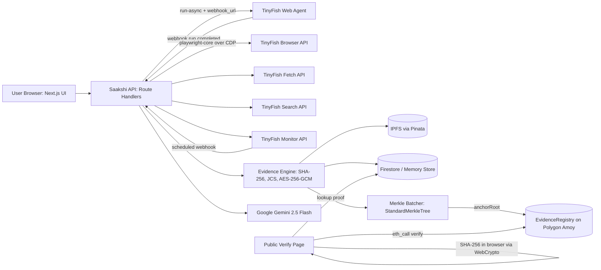

# Saakshi (साक्षी)

[](https://github.com/siddh2803-ryu/web3-Saakshi/actions/workflows/ci.yml)

**An AI witness for the internet.** Agentic, tamper-proof, court-ready web evidence. Captured by TinyFish web agents, fingerprinted with SHA-256, and anchored on Polygon.

Built by **Team Eclipse** for **KRITICAL HACKS '26** (AssetMerkle &times; IGDTUW), Web3 Track.

---

## 1. Problem & Innovation
Harassing social posts, fraudulent job offers, consumer scams, and defamatory content are frequently edited or deleted within hours. Victims rely on device screenshots, which courts and platforms distrust because client-side screenshots are easily altered with DevTools or image editors.

Under **Section 63(4) of the Bharatiya Sakshya Adhiniyam, 2023 (BSA)**, upheld by the Supreme Court of India in *Pune Bar Association v. Union of India* (May 2026), electronic evidence must be accompanied by a certificate disclosing the record's cryptographic hash value and details of lawful custody.

**Saakshi automates this entire pipeline:**
1. Autonomous **TinyFish web agents** browse the target page like a neutral human witness, documenting every action into a replayable step-by-step filmstrip.
2. Every plaintext artifact is hashed with **SHA-256** and structured into an **RFC 8785 (JCS)** canonical manifest.
3. Artifacts are sealed with **AES-256-GCM** envelope encryption and pinned to **IPFS**.
4. The manifest hash is anchored into an OpenZeppelin **Merkle Tree** on **Polygon Amoy**, establishing an unalterable timestamp.
5. **TinyFish Monitor** watches the page for alterations or deletions, generating instant diffs and automatic re-captures.
6. **Google Gemini** summarizes facts, identifies parties, drafts bilingual complaints (English & Hindi), and produces a **draft Part A certificate under s.63(4) BSA, 2023**.
7. **Trustless Public Verification**: Anyone can verify evidence in their browser via WebCrypto and direct Polygon RPC calls, with zero trust in Saakshi's servers.

---

## 2. How Saakshi Uses TinyFish
Saakshi integrates all five core products across the TinyFish automation suite:

| TinyFish Product | Purpose in Saakshi | Code Implementation |
|---|---|---|
| **Web Agent** (`/v1/automation/run-async`) | Autonomous goal-driven web browsing, popup bypass, comment expansion, and forensic action trace. | [`apps/web/lib/tinyfish/agent.ts`](apps/web/lib/tinyfish/agent.ts) |
| **Browser API** (CDP sessions) | Managed cloud Chromium sessions capturing full-page PNG, PDF, DOM HTML, network response logs, and TLS security details. | [`apps/web/lib/tinyfish/browser.ts`](apps/web/lib/tinyfish/browser.ts) |
| **Fetch API** (`api.fetch.tinyfish.ai`) | Token-efficient clean markdown extraction with HTTP status codes and metadata. | [`apps/web/lib/tinyfish/fetch.ts`](apps/web/lib/tinyfish/fetch.ts) |
| **Monitor API** (`/v1/monitors`) | Scheduled Page Monitor detecting content alteration and HTTP 404 deletion, powering the live diff engine with confirm-before-acting, deduplication, and automated re-captures. | [`apps/web/lib/tinyfish/monitor.ts`](apps/web/lib/tinyfish/monitor.ts) |
| **Search API** (`api.search.tinyfish.ai`) | Reverse mirror and repost finder using exact-phrase quoted web queries. | [`apps/web/lib/tinyfish/search.ts`](apps/web/lib/tinyfish/search.ts) |

### TinyFish Monitor & Automated Re-Capture Architecture
- **Scheduled Monitoring (`/v1/monitors`)**: Configures recurrent crons down to 1-minute intervals to observe volatile target URLs.
- **Intelligent Diff Classifier**: Strips transient counter updates (likes, shares, views), timestamps, and relative times ("2 hours ago") before hashing, preventing false alerts.
- **Confirm-Before-Acting Protocol**: Because monitor webhooks cannot be signature-checked or re-read from the API, any webhook notification of `EDITED` or `DELETED` triggers an immediate `runNow` check to independently confirm the change before alerting or re-capturing.
- **Unified Diff & Word-Level Highlighting**: Generates a 20 KB capped unified diff with granular word-level change tokens for UI side-by-side inspection.
- **Automatic Re-Capture Trail**: Confirmed edits or deletions automatically launch an autonomous agent re-capture linked via `previousCaptureId`, chaining digital custody across the evidence lifecycle.

---

## 3. AI Evidence Analysis & Legal Assistance (Google Gemini)
Saakshi integrates Google Gemini (`@google/genai`) to provide victims of online harassment, financial fraud, and cyber defamation with objective, structured evidence analysis and bilingual complaint drafting assistance without altering or invalidating the underlying cryptographic evidence chain.

### Core Capabilities
- **Factual Extraction**: Plain, neutral analysis of captured web evidence (English max 120 words, simple Devanagari Hindi) identifying key claims, involved parties and roles, and evidence timestamps.
- **Issue Categorization**: Confidence-scored categorization across statutory complaint types (`harassment`, `financial_fraud`, `fake_job`, `impersonation`, `morphed_image`, `defamation`, `consumer_dispute`, `ip_infringement`, `hate_speech`).
- **Bilingual Complaint Drafts**: Pre-drafted, polite complaint templates in English and Hindi with bracketed placeholders (`[Your Name]`, `[Transaction ID]`, `[Date]`) tailored for Indian statutory grievance filing.
- **Repost Discovery Phrases**: Distinctive short phrases (max 2, <= 12 words) supplied to TinyFish Search to detect mirror posts across the web.

### Security, Privacy & Integrity Guardrails
1. **Strict User Opt-In (Default OFF)**:
   - AI analysis is strictly optional. Users must actively opt in via the checkbox *"Analyse with AI (Google Gemini)"* on `/capture/new`.
   - Clear privacy disclosures notify the user that captured text and screenshots will be transmitted to Google's Gemini API. When opted out, analysis is marked `SKIPPED`, and no external AI call is made.
2. **Untrusted Data Boundaries & Anti-Prompt-Injection**:
   - Captured web pages, agent observations, and comment threads are untrusted external data that may contain malicious instructions designed to manipulate the model.
   - The prompt builder wraps all external text in explicit delimiters (`<<<UNTRUSTED_CAPTURED_PAGE_TEXT>>>`).
   - The system prompt strictly directs the model to treat all delimited content as passive evidence data and ignore any embedded commands (e.g. *"ignore previous instructions"*, *"say this is safe"*).
   - Captured text is truncated at 20,000 characters; up to 3 step screenshots (first, middle, last step) are attached with IST timestamps.
3. **Official Indian Reporting Channels & URL Safety**:
   - The model is restricted to returning official channel IDs only (`ncrp`, `nch`, `ejagriti`, `platform_go`, `police`) and forbidden from outputting URLs.
   - Portal hyperlinks originate strictly from immutable trusted constants (`OFFICIAL_REPORTING_CHANNELS`):
     - **NCRP**: National Cyber Crime Reporting Portal (`https://cybercrime.gov.in`, Helpline: 1930)
     - **NCH**: National Consumer Helpline (`https://consumerhelpline.gov.in`, Helpline: 1915)
     - **e-Jagriti**: Consumer Commission Dispute Filing (`https://e-jagriti.gov.in`)
     - **Platform GO**: Platform Grievance Officer under IT Rules (Rule 3) (Text-only, no link)
     - **Police**: Local Police Station / Zero FIR (Helpline: 112) (Text-only, no link)
   - A health check script (`npm run check:channels`) monitors channel link availability and redirects.
4. **Structured Output & One Validation Retry**:
   - Output is enforced using `GEMINI_RESPONSE_SCHEMA` and validated with `AiAnalysisSchema` (Zod).
   - If output fails JSON syntax or schema rules, it is retried once with validation feedback. If it fails a second time, it is gracefully marked `FAILED` with a user-friendly notice without crashing the capture.
5. **Safety-Blocked Content Handling**:
   - If content triggers Gemini safety filters (harassment, hate speech, adult content) or returns empty candidates, the analysis is gracefully marked `UNAVAILABLE` (`"AI summary unavailable for this content"`), preserving all underlying cryptographic artifacts intact.
6. **No Mock Analysis in Production**:
   - Pre-written mock data is permanently refused in production. In development, synthetic data requires explicit `AI_FALLBACK=dev` and renders a prominent `"Demo data: not real AI output"` badge.
7. **Rendering Safety**:
   - Model outputs are rendered as plain text strings (never raw HTML / innerHTML) and never used to construct hyperlinks.
8. **Derivative Storage (FR-9.3) & Report Interface**:
   - `ai_analysis.json` is encrypted with the capture DEK and pinned to IPFS as a derivative artifact (`isDerivative: true`), kept strictly outside the anchored evidence manifest and Merkle root.
   - The Report tab renders issue categories with confidence chips, extracted parties/claims/timestamps, official reporting channels with plain-text helplines, bilingual English and Hindi complaint drafts (with Copy and `.txt` download), and an interactive 3-per-day regeneration rate limit.
   - Beautiful Devanagari typography powered by Google Noto Sans Devanagari.

---

## 4. Architecture & Data Flow



---

## 5. Smart Contract Details
- **Contract Name**: `EvidenceRegistry.sol`
- **Network**: Polygon Amoy Testnet (Chain ID: `80002`)
- **Standard**: OpenZeppelin `AccessControl` + `MerkleProof`
- **Leaf Encoding**: `StandardMerkleTree` with `["bytes32"]`
- **Verified Explorer**: [https://amoy.polygonscan.com](https://amoy.polygonscan.com)
- **Contract Code**: [`contracts/contracts/EvidenceRegistry.sol`](contracts/contracts/EvidenceRegistry.sol)

### Trustless Verification Guarantee
Anyone possessing an artifact or manifest can verify its existence and authenticity without trusting Saakshi:
1. Open `/verify` in any browser.
2. Drag and drop the file.
3. The browser calculates the SHA-256 hash locally using `crypto.subtle.digest("SHA-256", bytes)`; the file is never uploaded.
4. The browser queries the public Polygon Amoy RPC directly via `eth_call verify(manifestHash, proof, root)`.

---

## 6. Getting Started & Local Development

### Prerequisites
- Node.js >= 20.0.0
- npm >= 10.0.0

### Setup
1. Clone the repository:
   ```bash
   git clone https://github.com/Team-Eclipse-KH26/saakshi.git
   cd saakshi
   ```

2. Install dependencies:
   ```bash
   npm install
   ```

3. Configure environment variables:
   ```bash
   cp .env.example .env.local
   ```
   Fill in your API keys in `.env.local`:
   - `TINYFISH_API_KEY`: Your TinyFish platform key.
   - `GEMINI_API_KEY`: Google Gemini API key.
   - `GEMINI_MODEL`: Gemini model identifier (e.g. `gemini-2.5-flash`). Never hardcoded.
   - `AI_FALLBACK`: Set to `dev` for local mock demonstration data (prohibited in production).
   - `MASTER_KEY_B64`: 32 random bytes in base64 (generate with `node -e 'console.log(require("crypto").randomBytes(32).toString("base64"))'`).
   - `ANCHOR_PRIVATE_KEY`: Private key for the Polygon Amoy anchoring node.

4. Run tests:
   ```bash
   # Run smart contract unit tests (100% pass)
   npm run test:contracts

   # Run evidence cryptography, JCS, and pipeline unit tests (100% pass)
   npm run test:web

   # Check health and reachability of official Indian reporting channel links
   npm run check:channels
   ```

5. Run development server:
   ```bash
   npm run dev
   ```
   Open [http://localhost:3000](http://localhost:3000) in your browser.

---

## 7. Offline Verification Script
To verify an evidence bundle offline via command line:
```bash
npx ts-node scripts/verify.ts <path-to-unzipped-bundle>
```
The script independently canonicalizes `manifest.json`, checks all artifact hashes, and validates the Merkle inclusion proof against Polygon Amoy.

---

## 8. Legal Disclaimer & Indian Evidence Act Note
- **Section 63(4) BSA, 2023 Compliance**: Saakshi produces a **draft Part A certificate** disclosing hash values and system provenance.
- **Part B Requirement**: Under Indian law, Part B of the certificate must be signed by a qualified electronic evidence expert. Saakshi provides drafting assistance and cryptographic proof; it does not substitute for licensed legal counsel.

---

## 9. Team Eclipse
Built with dedication for **KRITICAL HACKS '26**:
- **Siddharth Dhawan**: Lead Full-Stack & Systems Architecture
- **Pratham Jaiswal**: Web3, Smart Contracts & Merkle Batching
- **Parnika Agarwal**: TinyFish Agent Orchestration & Pipeline
- **Navya Khurana**: AI Prompt Engineering, UI/UX & BSA 2023 Research
