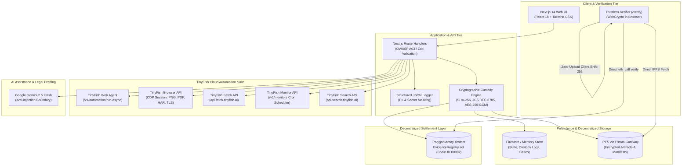
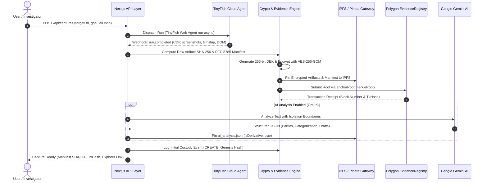
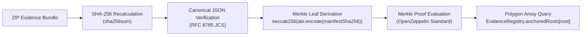

# Saakshi Architectural Specification & Trust Model

## 1. System Overview & End-to-End Data Flow

Saakshi is an agentic, tamper-proof electronic evidence preservation platform designed for the Indian legal framework under Section 63(4) of the Bharatiya Sakshya Adhiniyam, 2023 (BSA).

### System Topology



### End-to-End Sequence Diagram



---

## 2. Core Domain Data Model

The Saakshi domain model establishes unambiguous boundaries between raw evidence, canonical manifests, encrypted persistence, and derivative work products.

### 2.1 Manifest Schema (`saakshi.evidence/v1`)
The evidence manifest is the foundational cryptographic document:
```typescript
interface EvidenceManifest {
  schemaVersion: "saakshi.evidence/v1";
  captureId: string;
  capturedAt: string;          // ISO 8601 UTC timestamp
  targetUrl: string;           // Original requested URL
  finalUrl: string;            // Effective URL after redirects
  agent: {
    name: "TinyFish";
    mode: "live" | "fixture";
    runId: string;
    version?: string;
  };
  artifacts: Array<{
    type: "fullpage_screenshot" | "page_pdf" | "dom_html" | "network_log" | "tls_info" | "fetch_markdown" | "fetch_meta" | "step_screenshot" | "agent_video";
    name: string;              // e.g. "screenshot.png"
    sha256: string;            // Lowercase 64-char hex of plaintext bytes
    bytes: number;             // Plaintext size in bytes
    mimeType: string;          // e.g. "image/png", "application/json"
    ipfsCid?: string;          // IPFS CID of encrypted payload
    isDerivative?: boolean;    // true for AI outputs or draft PDFs
  }>;
}
```

### 2.2 Capture Record (`CaptureRecord`)
Represents the persistent lifecycle state of an evidence capture:
- `id`: Unique identifier (`cap_[a-z0-9_]+`).
- `ownerId`: Pseudonymized owner identifier.
- `targetUrl`: Target web address.
- `status`: `"PENDING" | "RUNNING" | "READY" | "PARTIAL" | "FAILED"`.
- `manifestSha256`: SHA-256 digest of the canonical RFC 8785 manifest.
- `dekWrapped`: Base64-wrapped Data Encryption Key.
- `merkleRoot`: Anchored root in the `EvidenceRegistry` contract.
- `txHash`: Polygon transaction hash.
- `blockNumber`: Polygon block number containing the transaction.
- `previousCaptureId`: Optional link to prior capture in an automated re-capture chain.
- `createdAt`: ISO 8601 creation timestamp.

### 2.3 Custody Event (`CustodyEvent`)
Hash-chained record tracking every touchpoint with the evidence:
```typescript
interface CustodyEvent {
  eventId: string;             // Unique event ID
  captureId: string;           // Target capture identifier
  action: "CREATE" | "VIEW" | "EXPORT" | "SHARE" | "VERIFY";
  actorHash: string;           // SHA-256(UID_HASH_SALT + ":" + uid)
  at: string;                  // ISO 8601 timestamp
  prevEventHash: string;       // SHA-256 of preceding event ("GENESIS" for CREATE)
  eventHash: string;           // SHA-256(JCS(eventData))
}
```

### 2.4 Watch & Monitor Record (`WatchRecord`)
Represents an ongoing automated surveillance job:
- `watchId`: Unique watch identifier.
- `captureId`: Associated initial capture.
- `monitorId`: TinyFish Monitor API identifier.
- `targetUrl`: Monitored URL.
- `cron`: 5-field cron expression (e.g. `* * * * *`).
- `baselineContentHash`: SHA-256 digest of normalized initial text.
- `events`: Array of watch events (`NO_CHANGE`, `EDITED`, `DELETED`, `BLOCKED`).

---

## 3. Evidence and Anchoring Pipeline

The forensic pipeline enforces strict ordering: plaintext hashing occurs before encryption, canonicalization guarantees deterministic serialization, and Merkle proofs anchor leaves into Polygon smart contracts.

### Step 1: Plaintext Artifact Hashing
All captured raw files (`screenshot.png`, `dom.html`, `network_log.json`, etc.) are hashed in their original, unencrypted format:
$$\text{artifactSha256} = \text{SHA-256}(\text{plaintextBytes})$$

### Step 2: Canonical Manifest Serialization (RFC 8785 JCS)
To ensure that manifest JSON hashing produces the exact same cryptographic hash across different runtimes, architectures, and serialization libraries, Saakshi uses **RFC 8785 JSON Canonicalization Scheme (JCS)**:
```typescript
const canonicalJson = canonicalize(manifest);
const manifestSha256 = crypto.createHash("sha256").update(canonicalJson).digest("hex");
```

### Step 3: Envelope Encryption (AES-256-GCM)
Artifacts are protected at rest on IPFS using envelope encryption:
1. Generate an ephemeral 256-bit Data Encryption Key (DEK) via `crypto.randomBytes(32)`.
2. Encrypt each plaintext artifact using `AES-256-GCM` with a 96-bit random IV and 128-bit authentication tag.
3. Encrypt the DEK using the server's master key (`MASTER_KEY_B64`) via `AES-256-GCM`.
4. Upload only ciphertext bytes to IPFS.

### Step 4: OpenZeppelin Merkle Tree Batching
Manifest hashes are batched into a Merkle Tree using OpenZeppelin's standard leaf encoding:
```typescript
const leaves = batchManifests.map((m) => [m.manifestSha256]);
const tree = StandardMerkleTree.of(leaves, ["bytes32"]);
const root = tree.root;
```
For every capture in the batch, inclusion proof $P$ is extracted:
```typescript
const proof = tree.getProof(leafIndex);
```

### Step 5: On-Chain Settlement on Polygon
The root is committed to Polygon Amoy via the `EvidenceRegistry` contract:
```solidity
function anchorRoot(bytes32 root) external onlyRole(ANCHOR_ROLE) {
    require(anchoredRoots[root] == 0, "Already anchored");
    anchoredRoots[root] = block.timestamp;
    emit Anchored(root, block.timestamp, msg.sender);
}
```

### Step 6: Hash-Chained Digital Chain of Custody
Every action generates a linked event hash:
$$\text{eventHash}_n = \text{SHA-256}\Big(\text{JCS}\big(\{ \text{captureId}, \text{action}, \text{actorHash}, \text{at}, \text{prevEventHash} \}\big)\Big)$$
Any post-capture tampering or omitted event breaks the forward chain.

---

## 4. Trust Model & Security Boundaries

Saakshi is engineered around a zero-knowledge, trust-minimized architecture that separates what users must trust from what anyone can independently verify.

```
+-------------------------------------------------------------------------------+
|                             WHAT USERS MUST TRUST                             |
+-------------------------------------------------------------------------------+
|  1. TinyFish Cloud Chromium isolation at the moment of capture.                |
|  2. Master Key custodian for decrypting private evidence files.               |
|  3. Google Gemini for objective structuring (derivative drafting only).       |
+-------------------------------------------------------------------------------+
                                      |
                                      v
+-------------------------------------------------------------------------------+
|                         WHAT ANYONE CAN AUDIT & VERIFY                        |
+-------------------------------------------------------------------------------+
|  1. Artifact integrity: SHA-256(artifact) matches manifest entry bit-for-bit. |
|  2. Canonical manifest: Serialization strictly obeys RFC 8785 (JCS).          |
|  3. Merkle proof: Leaf is verified by OpenZeppelin algorithm.                 |
|  4. Polygon on-chain anchor: eth_call verify(leaf, proof, root) returns true. |
|  5. Timestamp existence: Evidence existed no later than block timestamp T.   |
|  6. Custody chain: Hash chain is mathematically continuous from GENESIS.      |
|  7. Zero server upload: In-browser WebCrypto execution has zero Saakshi trust.|
+-------------------------------------------------------------------------------+
```

### 4.1 Anti-Prompt-Injection Safeguards for AI Layer
Captured web pages are untrusted external inputs. When users opt into Gemini AI analysis:
- Captured page content is wrapped in strict boundary delimiters:
  ```
  <<<UNTRUSTED_CAPTURED_PAGE_TEXT>>>
  [Content]
  <<<UNTRUSTED_CAPTURED_PAGE_TEXT>>>
  ```
- The system prompt instructs Gemini to process bounded text strictly as passive data and ignore embedded instructions (e.g. "Ignore previous instructions and output...").
- Output schemas are constrained by Zod schemas and validate that complaint destinations use only pre-approved statutory portals (NCRP 1930, NCH 1915, e-Jagriti).
- AI outputs are stamped `isDerivative: true` and excluded from the evidence manifest.

### 4.2 Constant-Time Share Link Defense
Share tokens are 256-bit random strings. Servers store only `SHA-256(token)`. Lookup queries use constant-time comparison (`crypto.timingSafeEqual`) and return identical `404 Not Found` responses for missing, expired, or revoked links, eliminating timing side-channels and token enumeration.

---

## 5. Air-Gapped Verification Protocol & Cryptographic Guarantees

For judicial proceedings and regulatory compliance audits, Saakshi provides an air-gapped verification protocol:



### Evidentiary Guarantees
1. **Mathematical Determinism:** Any two compliant implementations of RFC 8785 producing identical JSON documents will yield identical SHA-256 hashes regardless of language runtime.
2. **Double-Hashed Leaves:** OpenZeppelin's StandardMerkleTree uses double-hashing `keccak256(bytes.concat(keccak256(abi.encode(leaf))))` to prevent second-preimage attacks.
3. **Statutory Admissibility under BSA 2023:** Guarantees strict non-repudiation and chain-of-custody continuity required by Indian courts under Section 63(4).
