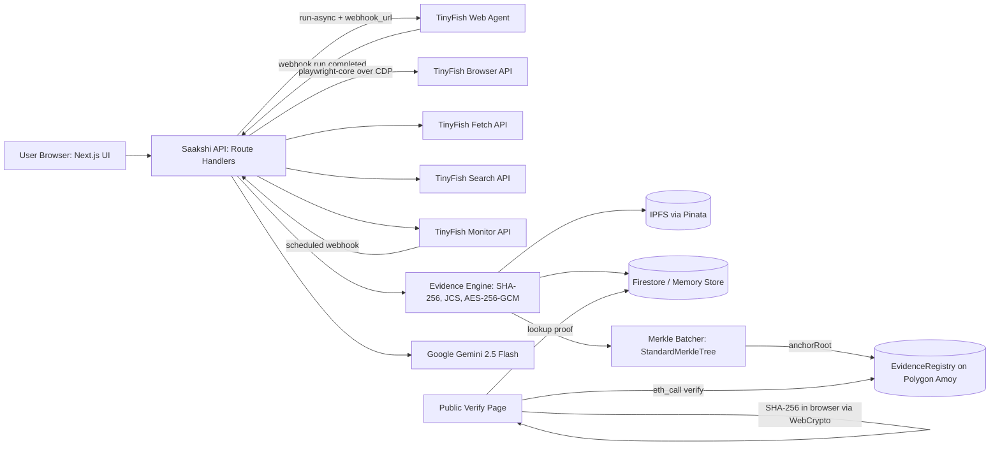

# Saakshi Architecture & Technical Reference

## 1. System Overview
Saakshi is an agentic, tamper-proof electronic evidence preservation platform designed for the Indian legal framework under Section 63(4) of the Bharatiya Sakshya Adhiniyam, 2023 (BSA).

## 2. Evidence Lifecycle & Cryptographic Guarantee
1. **Agent Capture**: Autonomous TinyFish Agent traverses target URL according to user goals. Each action step produces a timestamped base64 JPEG screenshot, forming a forensic filmstrip.
2. **Full-Fidelity Browser Capture**: Managed Chromium browser sessions via TinyFish Browser API over CDP capture full-page PNG, PDF, DOM HTML, network response log, and TLS certificate details.
3. **Clean Text Extraction**: Token-efficient markdown extraction via TinyFish Fetch API.
4. **Hashing Before Encryption**: SHA-256 hashes are computed over the **plaintext bytes** of each artifact before envelope encryption.
5. **Canonical Manifest**: Formatted according to schema `saakshi.evidence/v1` and serialized using RFC 8785 JSON Canonicalization Scheme (JCS).
6. **Envelope Encryption**: Unique 256-bit DEK per capture using AES-256-GCM (12-byte IV + 16-byte authTag). DEK wrapped with master key.
7. **Merkle Batching & Polygon Anchoring**: OpenZeppelin `StandardMerkleTree` with leaf encoding `["bytes32"]`. Root anchored to `EvidenceRegistry.sol` on Polygon Amoy.
8. **Trustless Client Verification**: Public verification computed in the browser using WebCrypto `SubtleCrypto` and queried directly to Polygon Amoy RPC nodes (`eth_call`).
